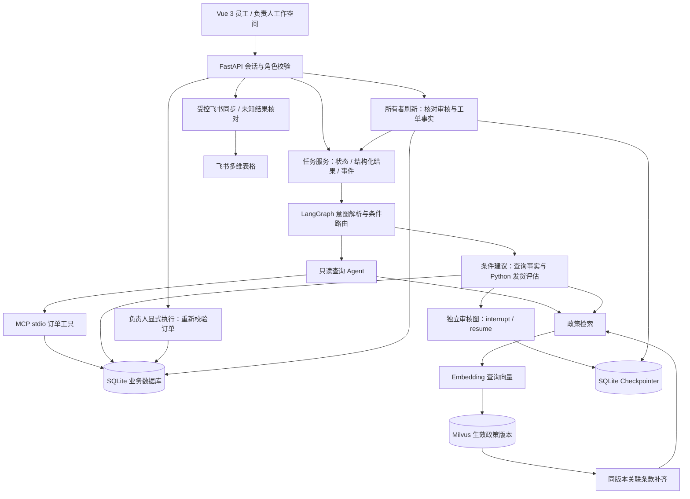

# BusinessFlow AI

面向企业售后场景的 AI 业务流程自动化学习项目。使用虚构数据演示：自然语言需求 → 订单查询 → 政策检索 → 待审核建议 → 人工审核 → 正式工单 → 飞书同步。

## 技术栈

Python 3.13、uv、FastAPI、LangChain、LangGraph、百炼 Qwen、MCP、Milvus、SQLAlchemy、SQLite、Vue 3 / JavaScript / CSS。

## 核心功能

- 只读 Agent 工具调用与 MCP 订单查询；Python 确定性发货判断。
- 政策 RAG、文档版本管理及来源追溯；单订单条件建议保存结构化事实。
- SQLite Checkpointer 人工审核中断/恢复，批准与实际执行分离。
- 按订单与问题类型阻止活跃申请重复提交，事务内防止重复创建活跃工单。
- 员工/负责人独立工作空间、自动核对任务进度、UTC+8 展示。
- 受控飞书同步；结果未知时核对远端，不自动盲目重发。

## 架构与执行边界



**模型理解需求，Python 校验业务条件，负责人批准，受控服务执行。** 普通查询 Agent 的订单工具通过 MCP；条件建议分支直接复用订单查询与评估函数。正式工单和飞书写入不作为任意写工具交给模型。

### 条件建议的一次请求

1. 模型提取意图与订单编号，Python 路由到条件建议分支。
2. 查询订单，以实际发货时间、承诺时间和服务端查询时刻确定是否超期未发货。
3. 符合条件后检索政策，检查处理建议与审核边界条款，分别保存事实、评估、来源和建议；不符合条件则返回查询结果，不启动审核。
4. 通过 `interrupt()` 暂停独立审核图，由 SQLite Checkpointer 持久化；负责人提交决定后使用同一 `thread_id` 和 `Command(resume=...)` 恢复。
5. 批准后仍需显式执行，重新检查当前订单；同一审核重复执行复用原工单，不同审核也不能重复创建同类活跃工单。
6. 员工页面自动核对进度，保留原查询事实；刷新不执行工单，也不自动同步飞书。

申请防重覆盖当前单进程任务和审核 API，工单执行由 SQLite 写事务与约束保护。飞书请求超时不等于写入失败，结果未知时先核对远端；不宣称跨系统绝对一次执行。

## 本地启动

需要 Python 3.13、uv、Node/npm，以及独立部署的 Milvus Standalone。Milvus、etcd 和 MinIO 应运行并健康；本仓库不包含现有 Docker 数据或凭证。

```powershell
uv sync --locked
```

仅在没有 `.env` 时复制 `.env.example`，填写自己的百炼配置；已有配置不要覆盖。模型名由 DASHSCOPE_MODEL 设置。飞书配置仅在使用同步功能时需要，不能将任何密钥放入前端 VITE_ 变量。

```powershell
uv run python -m app.db.init_all
cd frontend
npm ci
npm run build
cd ..
uv run uvicorn app.main:app --host 127.0.0.1 --port 8000
```

初始化显式建立表和虚构演示数据，不在应用启动时执行；已有任务结构升级可运行 `uv run python -m app.db.init_tasks`。

访问 http://127.0.0.1:8000/app/，选择员工或负责人演示账户；API 文档为 /docs，健康检查为 /health。首次使用知识库时，负责人在知识管理中上传 `knowledge/after_sales_policy.md`。该操作使用 Embedding 额度并写入 Milvus。

```powershell
uv run python -m scripts.preflight
```

预检只检查本地依赖与接口可达性，不验证模型Key有效性或政策内容，不创建业务数据。

## 测试与评测

```powershell
uv run python -m pytest -q -p no:cacheprovider --basetemp=./.pytest-review-tmp
cd frontend
npm test
npm run test:e2e
npm run build
cd ..
uv run python -m scripts.evaluate
```

浏览器测试使用已安装的 Google Chrome，模拟业务写入。可选 `npm run test:live` 需在 frontend 目录运行，并需要真实后端及现有演示订单。

可选真实调用会消耗模型/Embedding额度：

```powershell
uv run python -m scripts.evaluate --live --retrieval
uv run python -m scripts.smoke_mvp --live
```

evaluate 保存本地评测报告，不代表语义正确率；smoke_mvp 的业务和审核写入隔离在临时SQLite，不调用飞书。固定案例在 evaluations/，测试在 tests/ 与 frontend/tests、frontend/e2e。

## 目录

- app/api、schemas：HTTP 路由与数据契约。
- app/ai：模型、工具、RAG、任务图、审核与评测。
- app/services、repositories、db：业务规则、持久化及显式初始化。
- app/integrations：飞书适配器。
- frontend：Vue 源码、构建配置及测试。
- knowledge、evaluations：虚构政策与固定评测案例。
- scripts：预检、评测、隔离主链验收入口。

## 使用边界

本项目为 AI 辅助开发的个人学习 MVP，仅支持本地单进程部署；演示登录不是真实企业认证，无会话时仍支持 X-Demo-User，不能直接作为公网生产系统。申请侧使用单进程审核锁，两个SQLite库没有分布式事务，不提供所有业务和部署方式的绝对防重保证。多订单自由问答与历史任务仍保留文本兼容路径。政策为虚构测试材料，不构成真实企业承诺。

仓库不包含密钥、数据库、备份、模型回复报告、个人IDE配置或编译缓存。所有外部写入应使用自有测试账号与虚构数据。
